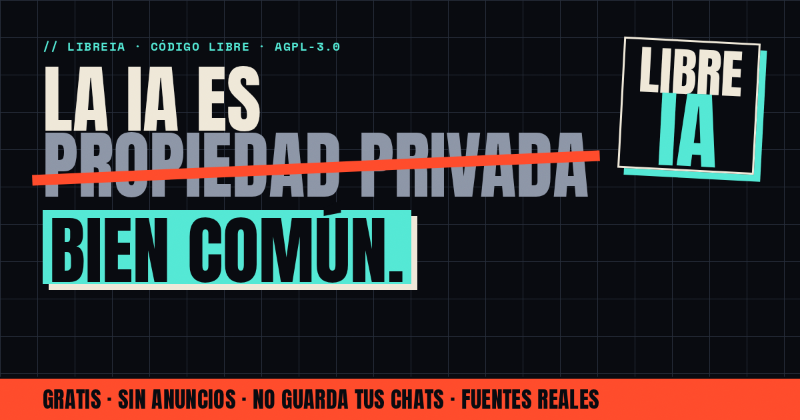

# LibreIA



**Inteligencia artificial libre, neutral y gobernada por su comunidad.**

LibreIA es un chat de IA gratuito que une varios modelos abiertos y gratuitos de distintos proveedores, busca en la web antes de responder y cita sus fuentes. No guarda tus chats, tu correo ni tu contraseña. Todo corre en el plan gratuito de Cloudflare.

- 🏴 Sitio y manifiesto: <https://libreia.pages.dev> (espejo: <https://humanx123.github.io/libreia/>)
- 💬 Chat web: <https://libre-ia.pages.dev> · [probar sin registro](https://libre-ia.pages.dev/?probar=1)
- 📱 APK Android: <https://libreia-api.libreia-chat-mobile.workers.dev/descargas/LibreIA-Chat.apk>
- ✉️ Contacto: <libreia@proton.me>

## Qué hace

- **Cuatro modos.** Neutral muestra los distintos puntos de vista. Libre responde de forma directa y sin sermones. Técnico está pensado para código. Fusión pone a varios modelos a responder a la vez y combina lo mejor de cada uno.
- **Varios proveedores.** Si un modelo falla o se queda sin cuota, responde el siguiente. La lista y el orden se editan desde el panel.
- **Búsqueda web con fuentes reales.** Usa Keenable, que no necesita clave, y Wikipedia como respaldo. Las fuentes se citan como `[1]` y se listan debajo de cada respuesta.
- **Markdown seguro.** Se muestra con `marked` y se limpia con `DOMPurify`.
- **Modo prueba.** Se puede chatear sin cuenta con un cupo por hora (sin Fusión ni votos). Los chats de prueba pasan a tu cuenta si te registras.
- **Comunidad.** Las personas usuarias proponen y votan mejoras: una cuenta, un voto.
- **Transparencia pública.** `GET /v1/transparencia` devuelve cifras agregadas de uso y de donaciones.

## Privacidad por diseño

| Dato | Qué pasa |
|---|---|
| Correo | Se transforma en el dispositivo con `SHA-256("libreia-correo:" + correo)` y nunca sale en claro. |
| Contraseña | Se deriva en el dispositivo con PBKDF2-SHA256 de 600 000 iteraciones y nunca sale en claro. Las cuentas creadas antes de la 0.10 (200 000 iteraciones) se refuerzan solas al volver a entrar. |
| Servidor | Solo guarda `HMAC(pepper, …)` de esos valores. Por eso **no hay recuperación de contraseña**. |
| Chats | Viven solo en el dispositivo. Se pueden exportar (JSON o Markdown), importar y borrar. |
| Uso | Solo hay contadores agregados (un id de instalación aleatorio, guardado como HMAC) y se pueden desactivar en la app. |
| Registros | `observability` está desactivado en el Worker principal: no se guardan IPs ni peticiones. |

## Estructura

```
src/                 App (Vite + TypeScript). La misma build sirve para la web y para la APK (Capacitor 7).
  main.ts            Vistas: acceso, chat, «¿Qué es LibreIA?», comunidad y configuración.
  api.ts             Cliente HTTP y criptografía de las cuentas (WebCrypto).
  contenido.ts       Manifiesto y textos de privacidad.
nube/src/            Worker principal (libreia-api)
  index.js           API compatible con OpenAI (/v1/*), cuentas, comunidad y transparencia.
  ia.js              Enrutador de modelos: lista de respaldo por modo, enfriamiento y Fusión.
  busqueda.js        Búsqueda web (Keenable y Wikipedia).
  motor.js           Configuración viva (catálogo, ajustes y claves cifradas en KV).
  comunidad.js       Durable Object: cuentas (solo huellas) y propuestas o votos.
  estadisticas.js    Durable Object: contadores anónimos agregados.
  catalogo.js        Catálogo de proveedores y modelos por defecto.
landing/             Sitio público (manifiesto, descarga, donaciones). Estático, sin dependencias.
admin/               Worker del panel de administración (libreia-admin). Usuario y contraseña, sesión HMAC.
android/             Proyecto Android de Capacitor.
```

## Monta tu propia LibreIA (gratis)

Necesitas una cuenta gratuita de Cloudflare y Node 20 o superior.

```bash
npm install
npm run build

# 1. Crea tu namespace de KV y pon su id (y tu account_id) en wrangler.jsonc y admin/wrangler.jsonc
npx wrangler kv namespace create CONFIG

# 2. Secretos del Worker principal (valores aleatorios largos)
#    MASTER_KEY = 32 bytes en base64. El resto, 32 bytes en hex.
npx wrangler secret put MASTER_KEY
npx wrangler secret put INTERNAL_TOKEN
npx wrangler secret put SESSION_KEY
npx wrangler secret put CUENTAS_PEPPER
#    Claves de los proveedores (o ponlas después desde el panel)
npx wrangler secret put KEY_GROQ

# 3. Cambia APP_TOKEN en wrangler.jsonc y en src/api.ts por un valor propio y despliega
npx wrangler deploy

# 4. Panel de administración
cd admin
npx wrangler deploy
#    Secretos: MASTER_KEY e INTERNAL_TOKEN (los mismos que arriba), SESSION_SECRET,
#    ADMIN_USER, ADMIN_PASS_HASH y ADMIN_PASS_SALT
#    (hash = PBKDF2-SHA256 de 10 000 iteraciones, en hex)
```

Para publicar todo de una vez (web, APK firmada, Worker, panel y sitio): `./publicar.sh`.

La APK se firma en modo *release* con la clave indicada en `android/keystore.properties`, que no se sube al repositorio. Para compilarla a mano: `npx cap sync android && cd android && ./gradlew assembleRelease`.

## Seguridad

- **Sesiones:** se firman con HMAC e incluyen una versión de la cuenta. Cambiar la contraseña, cerrar sesión o borrar la cuenta invalida las sesiones anteriores.
- **Límites persistentes** (Durable Objects): no se reinician cuando Cloudflare libera el objeto de memoria ni al redesplegar.
  - Por minuto, por cuenta o por red (las IPv6 se agrupan por /64).
  - Modo prueba: por instalación y por red.
  - Tope diario por cuenta.
  - Registros e inicios de sesión: por red y por cuenta.
- **Registro con captcha** (Cloudflare Turnstile, se puede desactivar desde el panel): el servidor valida cada token con Cloudflare y comprueba el host. Va antes del tope global diario, para que los bots no lo agoten.
- **Contraseñas:** 600 000 rondas de PBKDF2 en el dispositivo y después HMAC con una clave secreta en el servidor.
  - Si el limitador falla, los límites sensibles deniegan en vez de dejar pasar.
- **Respuestas de la IA:**
  - Se sanean con una lista estricta de etiquetas: sin formularios, estilos, ids ni atributos `data-`.
  - Las citas se enlazan después de sanear y nunca dentro del código.
  - Los resultados web se marcan como texto no confiable para el modelo.
- **Datos importados o guardados:** cada campo se valida y se reconstruye, así que un archivo malicioso o roto no rompe la app.
- **APK:** se publica en modo *release*, sin depuración, sin copias de seguridad en la nube y sin tráfico en claro.
- **Panel:**
  - Usar una clave con un host nuevo exige la contraseña.
  - Los intentos de contraseña están limitados.
  - El registro de la cuenta en KV va firmado.
  - Cerrar sesión invalida todas las sesiones.
  - Su cuenta, sus sesiones y su registro de acciones viven en un KV propio (`PANEL`), al que el Worker público no tiene acceso.

Si encuentras un fallo de seguridad, escribe a **libreia@proton.me** antes de publicarlo.

## Contribuir

Las contribuciones son bienvenidas: código, ideas, traducciones, difusión o recursos.

- Abre un *issue* o un *pull request* en este repositorio.
- Propón y vota mejoras en la sección **Comunidad** de la app.
- Escribe a **libreia@proton.me**, también si quieres donar por un medio distinto a las criptomonedas.

## Donaciones

Son voluntarias y pagan servidores y modelos mejores para todas las personas. Las direcciones y los QR están en la app (♥ Apoyar): USDC en Arbitrum, Bitcoin y Monero. Para otros medios, escribe a libreia@proton.me.

## Diseño

Toda la familia comparte la misma piel, un brutalismo de protesta: el sitio (`landing/`), la app web, la APK (`src/tema.css`) y el panel (`admin/src/ui.js`).

- **Logo:** la palabra **LIBRE**IA en Anton, con «IA» en cian `#53e8d4`. No hay ilustración.
- **Colores:** tinta `#090b10`, papel `#efe8d8`, cian `#53e8d4`, rojo `#ff4b2b` y ámbar `#e8c18b`.
- **Tipografías:** Anton para los titulares, Space Mono para las etiquetas y Archivo para el texto. Son fuentes OFL servidas desde el propio sitio, sin Google Fonts.
- **Forma:** esquinas rectas, bordes gruesos y sombras duras.

## Licencia

[AGPL-3.0-or-later](LICENSE). Puedes usar, estudiar, modificar y redistribuir LibreIA. Si ofreces una versión modificada como servicio, debes publicar también su código.

---

*Hecho xhumanx + IA*
